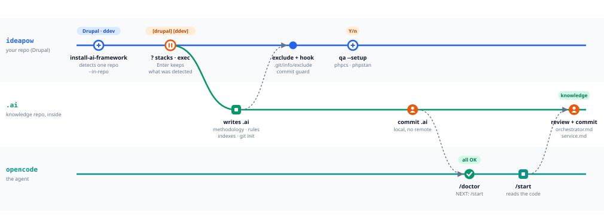
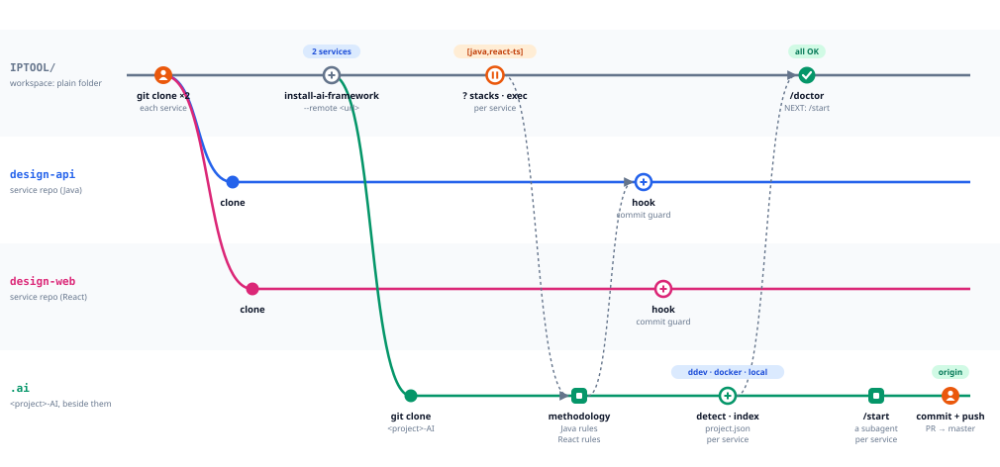
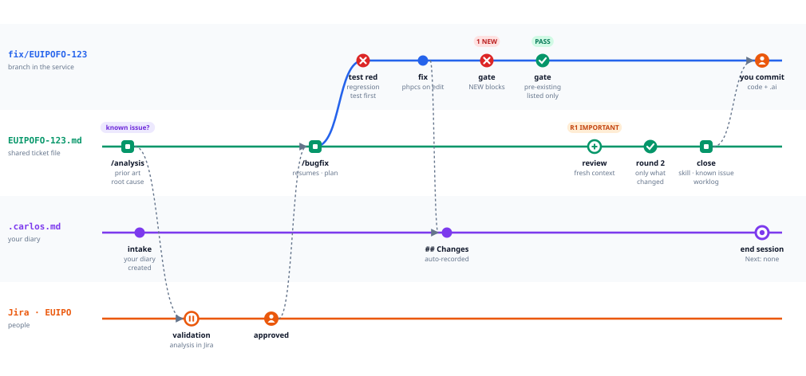
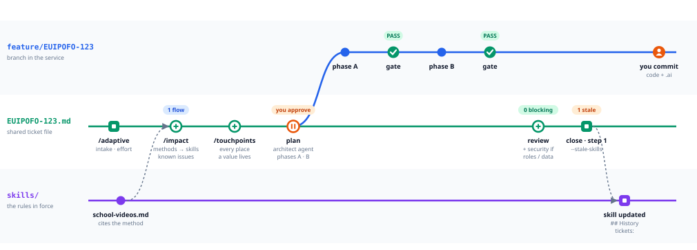
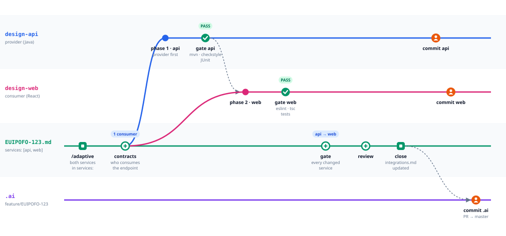
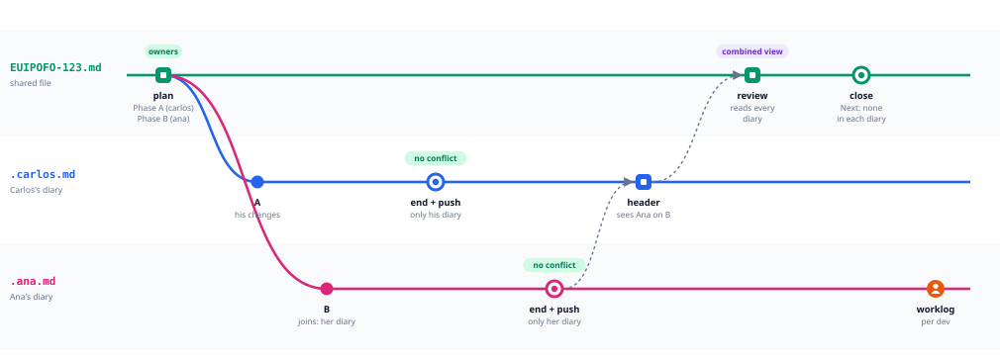
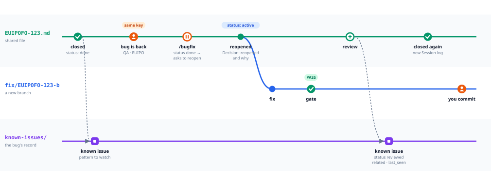
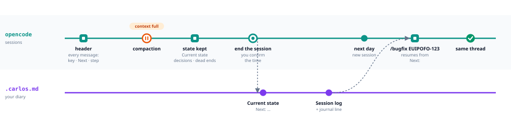

# ai-core: quick guide

How to use it: set up a project, take a ticket from the first command to the commit, work two on
one ticket, reopen one. Spanish: [quick-guide.es.md](quick-guide.es.md).

## The idea in one minute

1. **The knowledge is a git repository of its own, `.ai/`.** It holds the tickets, the skills (business flows and the
   rules in force), the known issues, the facts of each service and the methodology itself. Nothing AI ever enters
   the code repositories.
2. **One command per kind of ticket.** `/analysis` for a bug up to its analysis, `/bugfix` for the fix, `/adaptive`
   for a change or a new feature. Each one runs the whole flow and **stops where only you can decide**.
3. **Tools compute the facts, the model reasons on them.** They live in `.ai/scripts/` and need only Node 22.6 or
   later: the gate (only NEW findings block), the impact on business flows, the touchpoints, the review scope and
   `/doctor`.
4. **The agent never commits, pushes or switches branches.** You commit the code in its repository and the knowledge
   in `.ai/`.
5. **Every ticket is a folder** with a shared file and one **diary per developer**. A header on every message says
   which ticket you are on and what comes next.


## Two layouts: one repository or a workspace of services

| | **One repository** (`--in-repo`) | **Workspace of services** (default) |
|---|---|---|
| For | a monorepo or a single Drupal site (ideapow) | several repos that call each other (IP tool: Java and React) |
| `.ai/` | **inside** the repository, ignored by it (`.git/info/exclude`) | **beside** the services, in a plain folder |
| opencode opens in | the repository | the workspace folder, never inside a service |
| Services | the repository itself (`services: [ideapow]`) | each sub-folder with a `.git` |
| Gate | the stacks of the repository (root, `backend/`, `frontend/`…) | each changed service, in its own repo and exec |
| Contracts | not needed | `contracts` tells who consumes each endpoint |
| Commits | the code, and `.ai` | each service, and `.ai` |

```
ideapow/                    one repository              IPTOOL/                     workspace (no .git)
├─ .ai/        ← knowledge, ignored by ideapow         ├─ .ai/          ← <project>-AI clone
├─ composer.json · web/ …   the Drupal code            ├─ design-api/   ← git: Java service
└─ backend/ · frontend/     monorepo apps (optional)   └─ design-web/   ← git: React service
```

**The stacks decide the rules.** Java brings the Java rules (`java-enterprise.md` and `sonarqube.md`, loaded on every
message). Drupal and React load theirs with the service (`.ai/rules/stacks/`). SonarQube runs with `gate --sonar` for
every service that has a `sonar.projectKey`.

## !Two terminal commands, once per machine

```bash
bash ~/devel/ai-core/bin/install-commands.sh
```

It adds **`install-ai-framework`** and **`update-ai-framework`** to your WSL shell and to your Windows PowerShell. Both
work in the project folder you are in. They tell a single repository from a workspace of services, and a project on
the WSL disk from one on the Windows disk, and they always run inside WSL, where git, ddev and node are.

## Set up a project with one repository (ideapow)

```bash
cd ~/devel/bitbucket/ideapow && install-ai-framework
```



It asks four things, each with the detected value as the default. **Enter keeps it.**

| Question | Answer |
|---|---|
| `? Stacks [drupal]` | Enter (for several: `drupal,react-ts`) |
| `? Agent (opencode, claude-code, both) [opencode]` | Enter for opencode; `claude-code` for Claude Code; `both` for the two on the same project (`--agent` answers it) |
| `? Where the tools of . (drupal) run [ddev]` | Enter (or `docker`, `local`) |
| `? Install them now? [Y/n]`, only when phpcs or phpstan are missing | **Y** adds the composer packages, `phpcs.xml` and `phpstan.neon` (a commit in the repo, yours). **n** makes the gate mark them SKIPPED |

No remote is needed: `.ai` is a local git repository until you add one. It also records where it was installed from
(`.ai/framework.local.json`, personal), so **`/update-ai-framework`** can update it later. An update never asks again
what it already knows, such as the stacks, the exec and the agents saved in `.ai/project.json`.

To change it later: `update-ai-framework --agent claude-code` (or `opencode`, `both`), or `update-ai-framework
--reconfigure` to be asked again. It applies at once, even without a new version, and a project that stops using
Claude Code loses its `CLAUDE.md`.

With Claude Code the commands, agents and hooks go to `~/.claude`, and the project folder gets a `CLAUDE.md` that
only imports `.ai/` (excluded from git). The commands, the tickets and the tools are the same; start it with `claude`
in the project folder.

## Set up a workspace of services (IP tool)

```bash
mkdir -p ~/devel/IPTOOL && cd ~/devel/IPTOOL
git clone <design-api url> && git clone <design-web url>             # the services, side by side
install-ai-framework --remote <url of IPTOOL-AI>
```



`--remote` clones the team's `<project>-AI` as `.ai/`. An empty one starts a new knowledge base. Each service gets its
own stack, code paths and exec in `.ai/project.json`, and the gate runs each one in its own repository. Java gets its
rules on every message and Sonar through Maven.

## What the console shows

```console
  ▌ ai-core · AI workspace set-up (version 1.0.0)
  ▌ in-repo: one repository, .ai/ inside it

━━ 1/7 · Checks ━━━━━━━━━━━━━━━━━━━━━━━━━━━━━━━━━━━━━━━━━━━━━━━━━━━━
  project         ~/devel/bitbucket/ideapow  one git repository - .ai/ inside it
  services        ideapow  the repository itself

━━ 2/7 · Knowledge repository (.ai/) ━━━━━━━━━━━━━━━━━━━━━━━━━━━━━━━
  ✔ created a local git repository in .ai - no server needed, add a remote when you want to share it
  ✔ .ai/ is already ignored by the repository

━━ 3/7 · Stacks and methodology ━━━━━━━━━━━━━━━━━━━━━━━━━━━━━━━━━━━━
  ? Stacks (java, drupal, react-ts, several with commas) [drupal]:
  stacks          drupal  (the repository)
  ○ Java rules not installed - no Java service (--stack java adds them)
  ℹ SonarQube: gate --sonar at close, for every service with a sonar.projectKey
  ✔ drupal rules .ai/rules/stacks/drupal.md - loaded with the service (its service.md)

━━ 4/7 · Commit guard ━━━━━━━━━━━━━━━━━━━━━━━━━━━━━━━━━━━━━━━━━━━━━━
  ✔ .ai - commit guard installed (blocks secrets, e-mails and AI files in commits)
  ✔ ideapow - commit guard installed

━━ 5/7 · opencode wiring (this machine) ━━━━━━━━━━━━━━━━━━━━━━━━━━━━
  ✔ wiring 1.0.0 → /mnt/c/Users/<you>/.config/opencode (WSL: opencode runs on Windows)
  ✔ 21 files installed/updated (commands, agents, ticket plugin)

━━ 6/7 · Tools (.ai/scripts) ━━━━━━━━━━━━━━━━━━━━━━━━━━━━━━━━━━━━━━━
  + .                        drupal    composer.json requires drupal/core · tools run: ddev
  ? Where the tools of . (drupal) run - phpcs, drush, tests... (ddev, docker, local) [ddev]:
  ✔ codeindex: code-index.json written: 15 methods, 4 classes, 5 hooks, 60 fields
  ✔ apiindex: api-index.json written: 353 hooks, Drupal 10.6.19
  OK   drupal    phpcs       phpcs.xml
  OK   drupal    phpstan     phpstan.neon
  ✔ every code check is ready for the gate

━━ 7/7 · Summary ━━━━━━━━━━━━━━━━━━━━━━━━━━━━━━━━━━━━━━━━━━━━━━━━━━━
  project         ideapow  in-repo
  knowledge       .ai/  local repository - no remote yet
  stacks          drupal  no Java rules
  tools run       . → ddev
  code checks     ✔ phpcs  ✔ phpstan

━━ START WORKING ━━━━━━━━━━━━━━━━━━━━━━━━━━━━━━━━━━━━━━━━━━━━━━━━━━━
  ● 1  Commit the knowledge base (local - optional now, it keeps the history)
  │     git -C .ai add . && git -C .ai commit -m "[ideapow] ai-core 1.0.0"
  ● 2  Open opencode - restart the app if it is open
  │     folder: \\wsl.localhost\Ubuntu-24.04\home\<you>\devel\bitbucket\ideapow
  ● 3  /doctor - the set-up in one table
  ● 4  /start - first time only: it reads the code and writes the knowledge base
  ● 5  Your first ticket   bug: /analysis <KEY> → /bugfix <KEY>   evolutive: /adaptive <KEY>
  ● 6  Inside the ticket - the header on every message says the next step
  ● 7  Close - the agent never commits: you do
  ◉ 8  End of the day - "end the session": your diary keeps Current state and Next
```

Then, in opencode, run **`/doctor`**. It shows one table, the *Fixes (shortest first)* and the **▶ Next** line with the
step that comes now: `/start` the first time, otherwise the active ticket's step or a ticket command. **`/start`**
writes `orchestrator.md`, one `service.md` per service, `integrations.md` and `CONTEXT.md`. Review them and commit `.ai`.

## A teammate joins

```bash
git clone <url of the project's .ai repo> <repository or workspace>/.ai
bash .ai/install/install-opencode.sh          # the wiring of this machine (Windows: install-opencode.ps1)
```

Open a new opencode session and run `/doctor`. The first ticket command asks your GitLab username once, and your
diaries carry it.

## Everyday commands

| Command | When |
|---|---|
| `/analysis <KEY>` | a bug: prior art, evidence, root cause and the analysis in the Jira format |
| `/bugfix <KEY>` | the fix: regression test red then green, gate, review, test instructions, close |
| `/adaptive <KEY>` | a change or a feature: impact, plan in phases, gate per phase, review, close |
| `/gate` | the gate right now: runs the checks, fixes the NEW findings, runs again. The tool writes its own receipt in your diary. The flow also runs it after each phase |
| `/impact` · `/touchpoints <term>` | what else a change can break · every place a value lives |
| `/reviewer` · `/security` · `/tester` | the independent reviews (fresh context) and the test plan |
| `/architect` · `/learning [<KEY>]` | a plan for a large change · a skill from what a ticket taught (it gives its view first) |
| `/doctor` · `/start` · `/restart` | the set-up with ▶ Next · generate the knowledge base · refresh it against the code |
| `/update-ai-framework [--check]` | pulls the ai-core it was installed from and applies it when newer, or says there is no update |
| in a terminal: `install-ai-framework` · `update-ai-framework` | set the AI framework up in the project folder you are in · bring it up to date (without an install it tells you to install first) |

Say **"end the session"** before you stop. Your diary keeps the state and the time goes to your journal.

## !How to read the timelines

Time moves from left to right and each row is a branch, a file or a repository. A pill above a dot is what a tool
reported. A curve is a branch taken from another row. A dashed arrow is a tool or the agent acting on another row.


## Fix a bug (corrective)



1. `/analysis EUIPOFO-123` looks for known issues on the same code first, then for evidence and the root cause. When
   EUIPO validates the analysis, the ticket waits in `waiting-validation` and the same command resumes it after the
   approval. **An internal bug** with no EUIPO reference: answer `euipo_ref: none (internal)`. Nothing waits for EUIPO
   and `/bugfix` follows directly.
2. `/bugfix EUIPOFO-123` writes the regression test **red first**, then the fix. Each edit is recorded in your diary
   and linted on the spot (phpcs, hook signatures).
3. The gate runs after each phase, or with **`/gate`** whenever you want. **Only NEW findings block.** Pre-existing
   ones are listed and never fixed on the side. Never run phpcs, phpstan or drush by hand: the tool runs each one where
   it must. Each run leaves a **receipt** in your diary (see *Receipts* below).
4. The review runs in a fresh context. Its findings go to the ticket with ids, round 2 only checks what changed, and
   after two rounds you decide.
5. The close covers the skill decision (below), the known issue and the worklog draft. **You commit.**

## Add or change something (adaptive)



- `/impact` maps the diff, or the planned files, to **methods**. It then finds the skills, known issues and past
  tickets on those methods, which are the flows to re-test. `/touchpoints <value>` lists every place a value lives
  (in Drupal: option maps, permissions, form alters, config, Twig, `.po`).
- More than about three files, a contract, data or security means a plan in phases (the `architect` agent) with a gate
  per phase.
- At close, `impact --stale-skills` names every skill whose methods the ticket changed. Update it (`## History`,
  `tickets:`) or say why not. The ticket cannot close silently.

## A ticket across two services (workspace)



`services:` in the ticket is the permission, so a service not listed is not touched. **The provider goes before its
consumers.** Each service is gated in its own repository and exec, and `contracts` names who consumes a changed
endpoint. There is one commit per service and one for `.ai` (branch `feature/<KEY>`, a pull request to `master`).

## Two developers on one ticket



```
.ai/tickets/EUIPOFO-123/
├── EUIPOFO-123.md            shared: analysis, plan (each phase with its owner), impact, review, verification
├── EUIPOFO-123.carlos.md     Carlos's diary: Current state, Changes, Session log (only Carlos writes it)
└── EUIPOFO-123.ana.md        Ana's diary (only Ana writes it)
```

The second developer runs the same command with the same key. The ticket is resumed, Ana's diary is created and a line
`Decision: ana joins, phase B` is added. **Two developers never work the same phase.** Each header shows what the
other one is on, and the review and the close read every diary. Pushes never collide because each person writes only
their own file.

## Reopen a closed ticket



Run the ticket's command again with the same key (`/bugfix EUIPOFO-123`). The ticket is `status: done`, so it asks
whether to reopen it. Yes sets `status: active`, adds `Decision (date): reopened` with the reason, opens a new session
entry and a new branch in the service. At the next close the known issue is reviewed (`related`, `last_seen` and its
status).

## Never lose the thread



- **The header** comes with your message when it changed: the key, the services, the skills, your `Next:`, who else is
  on the ticket and the step its state calls for.
- **Compaction** keeps the ticket's state, decisions and dead ends in the summary, and the agent re-reads the ticket
  before acting.
- **"End the session"** leaves your diary's Current state ending with `Next:`. Tomorrow the command resumes from there.
- **Compact at the end of a phase.** Without a cache on the model server every call re-sends the whole conversation.
  When a phase has passed its gate and the conversation is over about 60,000 tokens, ▶ Next adds
  *compact the conversation*: write the Current state of your diary, then `/compact`. Never mid-phase. To start
  something unrelated, `/new` opens a clean conversation (the ticket lives in its files, not in the chat).

## ▶ Next, the step that comes now

Every finished command, `/doctor` and the header end with this line, followed by the chores that block nothing.

```
▶ Next · EUIPOFO-123: /gate — the changed code has no gate evidence yet
▷ Not blocking: commit the knowledge base (3 change(s)) — it goes to .ai's own repository, never to the project's
▷ Not blocking: share the knowledge base — create an empty repository ideapow-AI in GitLab or Bitbucket, then:
                git -C .ai remote add origin <its url> && git -C .ai push -u origin master
```

## What the header proposes

| The ticket's state | The step it proposes |
|---|---|
| a bug without `## Analysis` | `/analysis <KEY>` |
| a change without `## Impact analysis` | `impact --key <KEY>` and touchpoints |
| no code changed yet | the command: the plan, then the first change (the test first for a bug) |
| code changed after the last gate receipt | `/gate` |
| the last gate did not complete | what its receipt names (`ddev start`, `qa --setup`), then `/gate` |
| the last gate has NEW findings | fix them, then `/gate` again |
| open CRITICAL or IMPORTANT findings | fix them all at once, then the next review round (two rounds at most) |
| no review yet | the review, plus security when roles, data or endpoints change |
| no `## Test instructions` | the test instructions in the Jira format |
| no `## Knowledge` | close step 1: update the skill whose methods changed, or, when none covers it, propose one or recommend none (you decide) |
| everything there | close |

## Close: what has to be true

| Check | |
|---|---|
| Services | `services:` equals the services with changes (git log and status in each) |
| Gate receipt | the newest receipt says `exit 0` and `RESULT: PASS`, and no edit came after it. A `[VERIFIED]` gate line without a receipt is flagged |
| SonarQube | for a service with a `sonar.projectKey`: `gate --sonar` passes (quality gate OK, no new issues) |
| Review | a `Review:` verdict, and a person reviewed any change to auth, SQL, contracts or the data model |
| Knowledge | `## Knowledge` names every skill touched, and `impact --record` wrote *Code touched* |
| Known issue | written or updated for a real defect, with the indexes updated |
| Jira | analysis and test instructions pasted. **You are asked**, the agent never ticks it |

**The skill decision.** When no skill covers what the ticket touched, the close shows this and waits for your answer:

```
Skill: school videos language filter
- Recurrence:     yes, IDPO-32 already changed this filter
- Specialisation: yes, hiding UKR and GE is a client decision
- Payoff:         yes, the next change finds the rule and its key files
Proposal: 01-school-videos-language-filter · idpow_custom_form_alter()        Create it? (yes / no)
```

The question has exactly two answers: **create the skill**, or **no skill** with the reason, and then the rule stays
in the ticket's Notes as a `Decision` line. A business rule never goes to `.ai/CONTEXT.md`, and the decision is never
skipped.

Only your answer goes to `## Knowledge`, one line per skill named by its file:
`01-school-videos-language-filter — created from this ticket: <the rule>` or `… — updated by this ticket: <what changed>`.
What moved to the skill leaves the ticket and becomes `→ 01-school-videos-language-filter`. The skill lists the ticket in
its `tickets:` and the ticket lists the skill in `skills:`, so the header shows it. After the close, ▶ Next says what was
decided: *skill created from this ticket ✓*, *updated by this ticket ✓* or *not needed*, with the reason. `/learning <KEY>` gives its view on a declined skill and asks before
creating it anyway.

Then come `## Closure`, the worklog draft and **one commit message per repository**. You commit.

## Receipts: the gate's result, written by the tool

The model never writes the gate's result. The gate writes it, one line in your diary under `## Receipts`, replaced on
every run:

```
- gate project · 2026-11-13 10:17 · exit 0 · "RESULT: PASS" · @3d2b56d · #e8dd68c7
```

The full output stays in `.ai/context/receipts/` (local, never committed). ▶ Next and the close read the receipt, not
what the model says: an edit after it means `/gate` again, and an incomplete gate is never green. At the close,
`receipts fold <KEY>` turns it into one line of `## Verification`, removes it from your diary and deletes the local
output. `node .ai/scripts/ai.mjs receipts` shows the active ticket's.

## A compact ticket

The ticket is re-read at every step, so it keeps each fact once. While you work, the list of files with their reason
lives in your diary. At the close the agent shows what it removes, then compacts the ticket:

| Section | What stays |
|---|---|
| `## Changes` | only the generated *Code touched* block, with this ticket's files only |
| `## Review` | the open and wontfix rows, plus one line per round for the fixed ones |
| `## Impact analysis` | one `Impact:` line per flow, the risks and the rollback, never a list of files again |
| `## Verification` | one line per check, the gate as its folded receipt |
| `Notes` | a decision that moved to a skill ends in `→ <skill>` |

On EUIPOFO-123 the shared file went from about 1,780 to 1,255 tokens (30% less) with nothing lost.

## Lighter sessions

Each call re-sends the conversation, so the framework keeps out of it what is not needed now.

| What | How |
|---|---|
| A new ticket | `ticket new <KEY>` writes it from the template (same keys and sections, no comments, owner, dates, branch and baseline from git). The agent never reads the template: about 700 tokens instead of 2,850 |
| The procedures | read in parts: the close reads its extra checks (`close-when.md`) only for a corrective, a contract or an abandoned ticket. Creating a skill reads `skills.md`, not the whole knowledge policy (about 1,900 tokens instead of 6,900) |
| The subagents | reviewer, security and architect hand back a short report in a fixed shape (verdict, findings table, a `Clean:` line). The plan stays in its file. They do not re-read the instructions they already have |
| The ticket | compacted at the close (see *A compact ticket*), and the conversation compacted at the end of a phase |

## opencode on Windows, the project in WSL

Windows has no git, ddev or drush for a project in WSL, so the tools cross over by themselves:

- `node .ai/scripts/ai.mjs …` runs itself inside WSL.
- A **read-only git** command the agent runs (`git status`, `git log`, `git diff`…) is turned by the plugin into
  `node .ai/scripts/ai.mjs git -C <folder> …`. A git command that writes is left alone and stays yours.
- **`drush …` and `ddev drush …`** run exactly as written, inside WSL. The command travels encoded so PowerShell
  cannot touch its quotes, and you see it in full as a comment at the end. One command only.
- Drush is allowed in full, always by its **real command names** (`drush config:import`, `cache:rebuild`,
  `config:export`), never a short alias nor anybody's own shell alias.

## Keep it up to date

| What | How |
|---|---|
| A new version of the AI framework | **`update-ai-framework`** in a terminal, or **`/update-ai-framework`** in opencode. It pulls ai-core and applies it when newer, without questions. Then restart opencode |
| Changes in ai-core not committed yet | the update says so and applies nothing. `update-ai-framework --force` applies the working copy as it is |
| `install-ai-framework` in a project that has it | it says it is already installed and does nothing. Use the update |
| The team changed `.ai/install/` | `git -C .ai pull`, then `bash .ai/install/install-opencode.sh` |
| A service added or moved | `node .ai/scripts/ai.mjs detect --write`, then `/restart` |

## Common problems

| You see | Do |
|---|---|
| *Request blocked: prompt injection attempt detected* | `node .ai/scripts/ai.mjs promptcheck` names the file and the line |
| `/doctor` INFO `you` | only information: the developer name used for your diaries, from git (`user.name`) or from `owner:` in `.ai/MEMORY.local.md`. A WARN only when git has no name |
| the gate says `ddev is not running` | `ddev start`, then the gate again |
| commands missing in opencode | restart the app, it reads its configuration only at start. See the *commands* row of `/doctor` |
| WARN `rules` (Java rules without Java) | `install.sh --update-methodology` installs the rules of the stacks found |
| `install.sh` stops with *inside the git repository* | for a single repository add `--in-repo`. For a workspace, point at the folder that holds the services |
| opencode on Windows, the project in WSL | nothing to do: the tools, read-only git and drush cross into WSL by themselves (see the section above) |
| an old command still listed (`/update-framework`) | the next update removes it from opencode. Restart the app |
| the agent says git "is not available" in a long conversation | it is repeating an old conclusion: tell it git works now, or `/compact` |
| `/update-ai-framework` says *no record* | run `update-ai-framework` in a terminal at the root of the project. It writes `.ai/framework.local.json` |
| `update-ai-framework` says *no AI framework yet* | the project has no `.ai/`: run `install-ai-framework` first |
| `install-ai-framework` is not found | run `bin/install-commands.sh` of ai-core once, then open a new terminal |
