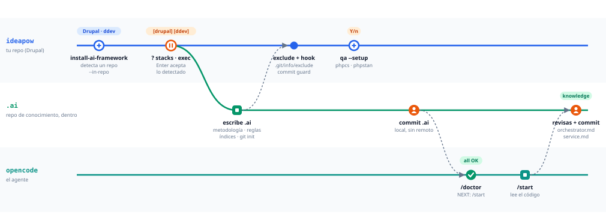
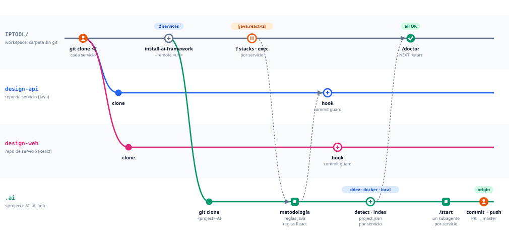
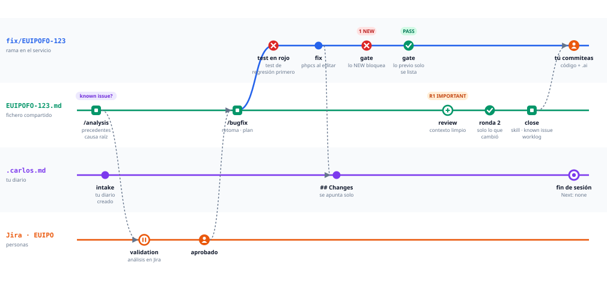
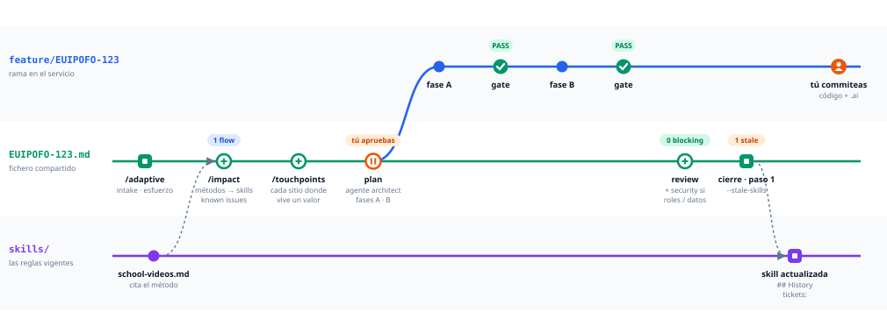
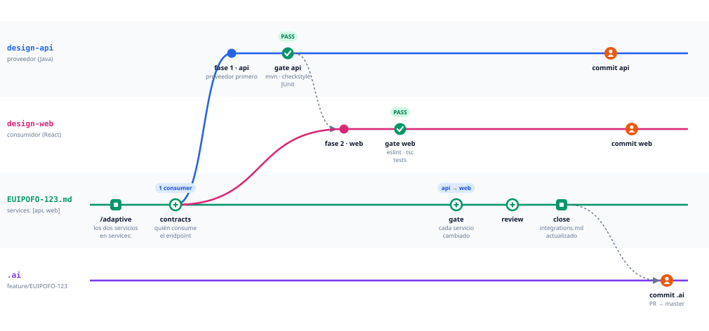
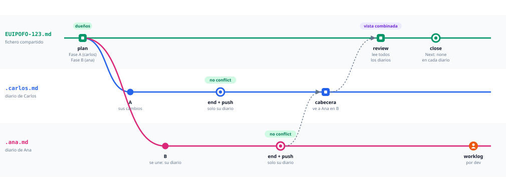
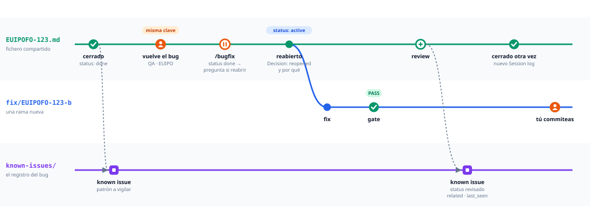
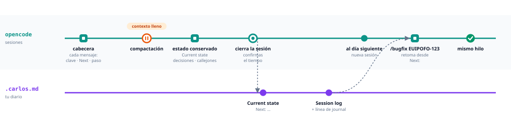

# ai-core: guía rápida

Cómo usarlo: montar un proyecto, llevar un ticket del primer comando al commit, trabajar dos en un
ticket y reabrir uno. Inglés: [quick-guide.en.md](quick-guide.en.md).

## La idea en un minuto

1. **El conocimiento es un repositorio git propio, `.ai/`.** Guarda los tickets, las skills (los flujos de negocio y
   las reglas vigentes), los known issues, los datos de cada servicio y la propia metodología. Nada de IA entra nunca
   en los repos de código.
2. **Un comando por tipo de ticket.** `/analysis` para un bug hasta su análisis, `/bugfix` para el arreglo y
   `/adaptive` para un cambio o una funcionalidad nueva. Cada uno recorre el flujo entero y **se para donde solo tú
   puedes decidir**.
3. **Las herramientas calculan los hechos y el modelo razona sobre ellos.** Viven en `.ai/scripts/` y solo necesitan
   Node 22.6 o superior: el gate (solo bloquean los hallazgos NEW), el impacto en los flujos de negocio, los
   touchpoints, el alcance de la revisión y `/doctor`.
4. **El agente nunca hace commit, push ni cambia de rama.** Tú commiteas el código en su repositorio y el conocimiento
   en `.ai/`.
5. **Cada ticket es una carpeta** con un fichero compartido y **un diario por desarrollador**. Una cabecera en cada
   mensaje dice en qué ticket estás y qué viene después.


## Dos formas: un repositorio o un workspace de servicios

| | **Un repositorio** (`--in-repo`) | **Workspace de servicios** (por defecto) |
|---|---|---|
| Para | un monorepo o un Drupal (ideapow) | varios repos que se llaman entre sí (IP tool: Java y React) |
| `.ai/` | **dentro** del repositorio, ignorado por él (`.git/info/exclude`) | **al lado** de los servicios, en una carpeta sin git |
| opencode se abre en | el repositorio | la carpeta workspace, nunca dentro de un servicio |
| Servicios | el propio repositorio (`services: [ideapow]`) | cada subcarpeta con `.git` |
| Gate | los stacks del repositorio (raíz, `backend/`, `frontend/`…) | cada servicio cambiado, en su repo y su exec |
| Contratos | no hacen falta | `contracts` dice quién consume cada endpoint |
| Commits | el código y `.ai` | cada servicio y `.ai` |

```
ideapow/                    un repositorio              IPTOOL/                     workspace (sin .git)
├─ .ai/        ← conocimiento, ignorado por ideapow    ├─ .ai/          ← clon de <project>-AI
├─ composer.json · web/ …   el código Drupal           ├─ design-api/   ← git: servicio Java
└─ backend/ · frontend/     apps del monorepo (opc.)   └─ design-web/   ← git: servicio React
```

**Los stacks deciden las reglas.** Java trae las reglas Java (`java-enterprise.md` y `sonarqube.md`, cargadas en cada
mensaje). Drupal y React cargan las suyas con el servicio (`.ai/rules/stacks/`). SonarQube corre con `gate --sonar` en
cada servicio que tenga `sonar.projectKey`.

## !Dos comandos de terminal, una vez por máquina

```bash
bash ~/devel/ai-core/bin/install-commands.sh
```

Añade **`install-ai-framework`** y **`update-ai-framework`** a tu shell de WSL y a tu PowerShell de Windows. Los dos
funcionan en la carpeta del proyecto en la que estés. Distinguen un solo repositorio de un workspace de servicios, y un
proyecto en el disco de WSL de uno en el de Windows, y siempre se ejecutan dentro de WSL, donde están git, ddev y node.

## Montar un proyecto de un solo repositorio (ideapow)

```bash
cd ~/devel/bitbucket/ideapow && install-ai-framework
```



Pregunta cuatro cosas, cada una con lo detectado como valor por defecto. **Enter lo acepta.**

| Pregunta | Respuesta |
|---|---|
| `? Stacks [drupal]` | Enter (para varios: `drupal,react-ts`) |
| `? Agent (opencode, claude-code, both) [opencode]` | Enter para opencode; `claude-code` para Claude Code; `both` para los dos en el mismo proyecto (`--agent` lo responde) |
| `? Where the tools of . (drupal) run [ddev]` | Enter (o `docker`, `local`) |
| `? Install them now? [Y/n]`, solo si faltan phpcs o phpstan | **Y** añade los paquetes composer, `phpcs.xml` y `phpstan.neon` (un commit en el repo, tuyo). **n** hace que el gate los marque SKIPPED |

No hace falta remoto: `.ai` es un repositorio git local hasta que le añadas uno. Además guarda desde dónde se instaló
(`.ai/framework.local.json`, personal), para que **`/update-ai-framework`** pueda actualizarlo después. Una actualización
nunca vuelve a preguntar lo que ya sabe, como los stacks, el exec y los agentes guardados en `.ai/project.json`.

Para cambiarlo después: `update-ai-framework --agent claude-code` (u `opencode`, `both`), o `update-ai-framework
--reconfigure` para que vuelva a preguntar. Se aplica al momento, aunque no haya versión nueva, y un proyecto que deja
Claude Code pierde su `CLAUDE.md`.

Con Claude Code los comandos, agentes y hooks van a `~/.claude`, y la carpeta del proyecto recibe un `CLAUDE.md` que
solo importa `.ai/` (excluido de git). Los comandos, los tickets y las herramientas son los mismos; se arranca con
`claude` en la carpeta del proyecto.

## Montar un workspace de servicios (IP tool)

```bash
mkdir -p ~/devel/IPTOOL && cd ~/devel/IPTOOL
git clone <url design-api> && git clone <url design-web>             # los servicios, uno al lado del otro
install-ai-framework --remote <url de IPTOOL-AI>
```



`--remote` clona el `<project>-AI` del equipo como `.ai/`. Uno vacío empieza una base de conocimiento nueva. Cada
servicio tiene su stack, sus rutas y su exec en `.ai/project.json`, y el gate corre cada uno en su propio repositorio.
Java tiene sus reglas en cada mensaje y Sonar con Maven.

## Qué se ve en la consola

```console
  ▌ ai-core · AI workspace set-up (version 1.0.0)
  ▌ in-repo: one repository, .ai/ inside it

━━ 1/7 · Checks ━━━━━━━━━━━━━━━━━━━━━━━━━━━━━━━━━━━━━━━━━━━━━━━━━━━━
  project         ~/devel/bitbucket/ideapow  one git repository - .ai/ inside it
  services        ideapow  the repository itself

━━ 2/7 · Knowledge repository (.ai/) ━━━━━━━━━━━━━━━━━━━━━━━━━━━━━━━
  ✔ created a local git repository in .ai - no server needed, add a remote when you want to share it
  ✔ .ai/ is already ignored by the repository

━━ 3/7 · Stacks and methodology ━━━━━━━━━━━━━━━━━━━━━━━━━━━━━━━━━━━━
  ? Stacks (java, drupal, react-ts, several with commas) [drupal]:
  stacks          drupal  (the repository)
  ○ Java rules not installed - no Java service (--stack java adds them)
  ℹ SonarQube: gate --sonar at close, for every service with a sonar.projectKey
  ✔ drupal rules .ai/rules/stacks/drupal.md - loaded with the service (its service.md)

━━ 4/7 · Commit guard ━━━━━━━━━━━━━━━━━━━━━━━━━━━━━━━━━━━━━━━━━━━━━━
  ✔ .ai - commit guard installed (blocks secrets, e-mails and AI files in commits)
  ✔ ideapow - commit guard installed

━━ 5/7 · opencode wiring (this machine) ━━━━━━━━━━━━━━━━━━━━━━━━━━━━
  ✔ wiring 1.0.0 → /mnt/c/Users/<you>/.config/opencode (WSL: opencode runs on Windows)
  ✔ 21 files installed/updated (commands, agents, ticket plugin)

━━ 6/7 · Tools (.ai/scripts) ━━━━━━━━━━━━━━━━━━━━━━━━━━━━━━━━━━━━━━━
  + .                        drupal    composer.json requires drupal/core · tools run: ddev
  ? Where the tools of . (drupal) run - phpcs, drush, tests... (ddev, docker, local) [ddev]:
  ✔ codeindex: code-index.json written: 15 methods, 4 classes, 5 hooks, 60 fields
  ✔ apiindex: api-index.json written: 353 hooks, Drupal 10.6.19
  OK   drupal    phpcs       phpcs.xml
  OK   drupal    phpstan     phpstan.neon
  ✔ every code check is ready for the gate

━━ 7/7 · Summary ━━━━━━━━━━━━━━━━━━━━━━━━━━━━━━━━━━━━━━━━━━━━━━━━━━━
  project         ideapow  in-repo
  knowledge       .ai/  local repository - no remote yet
  stacks          drupal  no Java rules
  tools run       . → ddev
  code checks     ✔ phpcs  ✔ phpstan

━━ START WORKING ━━━━━━━━━━━━━━━━━━━━━━━━━━━━━━━━━━━━━━━━━━━━━━━━━━━
  ● 1  Commit the knowledge base (local - optional now, it keeps the history)
  │     git -C .ai add . && git -C .ai commit -m "[ideapow] ai-core 1.0.0"
  ● 2  Open opencode - restart the app if it is open
  │     folder: \\wsl.localhost\Ubuntu-24.04\home\<you>\devel\bitbucket\ideapow
  ● 3  /doctor - the set-up in one table
  ● 4  /start - first time only: it reads the code and writes the knowledge base
  ● 5  Your first ticket   bug: /analysis <KEY> → /bugfix <KEY>   evolutive: /adaptive <KEY>
  ● 6  Inside the ticket - the header on every message says the next step
  ● 7  Close - the agent never commits: you do
  ◉ 8  End of the day - "end the session": your diary keeps Current state and Next
```

Después, en opencode, lanza **`/doctor`**. Muestra una tabla, los *Fixes (shortest first)* y la línea **▶ Next** con el
paso que toca: `/start` la primera vez, y si no el paso del ticket activo o un comando de ticket. **`/start`** escribe
`orchestrator.md`, un `service.md` por servicio, `integrations.md` y `CONTEXT.md`. Revísalos y commitea `.ai`.

## Se une un compañero

```bash
git clone <url del repo .ai del proyecto> <repositorio o workspace>/.ai
bash .ai/install/install-opencode.sh          # el cableado de esta máquina (Windows: install-opencode.ps1)
```

Abre una sesión nueva de opencode y lanza `/doctor`. El primer comando de ticket te pide tu usuario de GitLab una vez,
y tus diarios lo llevan en el nombre.

## Comandos del día a día

| Comando | Cuándo |
|---|---|
| `/analysis <KEY>` | un bug: precedentes, evidencias, causa raíz y el análisis en formato Jira |
| `/bugfix <KEY>` | el arreglo: test de regresión en rojo y luego en verde, gate, revisión, instrucciones de prueba, cierre |
| `/adaptive <KEY>` | un cambio o una funcionalidad: impacto, plan por fases, gate por fase, revisión, cierre |
| `/gate` | el gate ahora mismo: pasa las comprobaciones, arregla lo NEW, y repite. La herramienta escribe su propio recibo en tu diario. El flujo también lo lanza tras cada fase |
| `/impact` · `/touchpoints <término>` | qué más puede romper un cambio · cada sitio donde vive un valor |
| `/reviewer` · `/security` · `/tester` | las revisiones independientes (contexto limpio) y el plan de pruebas |
| `/architect` · `/learning [<KEY>]` | un plan para un cambio grande · una skill con lo que enseñó un ticket (antes da su opinión) |
| `/doctor` · `/start` · `/restart` | el estado con ▶ Next · generar la base de conocimiento · refrescarla contra el código |
| `/update-ai-framework [--check]` | hace pull del ai-core desde el que se instaló y lo aplica si es más nuevo, o dice que no hay actualización |
| en una terminal: `install-ai-framework` · `update-ai-framework` | instala el framework de IA en la carpeta del proyecto en la que estés · lo actualiza (sin instalación previa te pide instalar primero) |

Di **"cierra la sesión"** antes de parar. Tu diario guarda el estado y el tiempo va a tu journal.

## !Cómo leer las timelines

El tiempo avanza de izquierda a derecha y cada fila es una rama, un fichero o un repositorio. Una etiqueta encima de un
punto es lo que reportó una herramienta. Una curva es una rama que sale de otra fila. Una flecha discontinua es una
herramienta o el agente actuando sobre otra fila.


## Arreglar un bug (correctivo)



1. `/analysis EUIPOFO-123` busca primero known issues en el mismo código y después evidencias y la causa raíz. Si EUIPO
   valida el análisis, el ticket espera en `waiting-validation` y el mismo comando lo retoma tras la aprobación.
   **Un bug interno** sin referencia de EUIPO: contesta `euipo_ref: none (internal)`. No se espera a EUIPO y `/bugfix`
   sigue directamente.
2. `/bugfix EUIPOFO-123` escribe el test de regresión **primero en rojo** y después el arreglo. Cada edición se apunta
   en tu diario y pasa el linter al momento (phpcs, firmas de hooks).
3. El gate corre tras cada fase, o con **`/gate`** cuando quieras. **Solo bloquean los hallazgos NEW.** Los previos se
   listan y nunca se arreglan de paso. Nunca lances phpcs, phpstan o drush a mano: la herramienta corre cada uno donde
   debe. Cada ejecución deja un **recibo** en tu diario (ver *Recibos* más abajo).
4. La revisión se hace con contexto limpio. Sus hallazgos van al ticket con un id, la ronda 2 solo mira lo que cambió
   y tras dos rondas decides tú.
5. El cierre incluye la decisión de la skill (más abajo), el known issue y el borrador del worklog. **Tú commiteas.**

## Añadir o cambiar algo (evolutivo)



- `/impact` traduce el diff, o los ficheros del plan, a **métodos**. Después busca las skills, los known issues y los
  tickets pasados sobre esos métodos, que son los flujos a volver a probar. `/touchpoints <valor>` lista cada sitio
  donde vive un valor (en Drupal: mapas de opciones, permisos, form alters, config, Twig, `.po`).
- Más de unos tres ficheros, un contrato, datos o seguridad implican un plan por fases (el agente `architect`) con un
  gate por fase.
- En el cierre, `impact --stale-skills` nombra cada skill cuyos métodos cambió el ticket. Se actualiza (`## History`,
  `tickets:`) o se explica por qué no. El ticket no puede cerrarse en silencio.

## Un ticket en dos servicios (workspace)



`services:` en el ticket es el permiso, así que un servicio que no está en la lista no se toca. **El proveedor va
antes que sus consumidores.** Cada servicio pasa el gate en su repositorio y su exec, y `contracts` dice quién consume
un endpoint cambiado. Hay un commit por servicio y otro para `.ai` (rama `feature/<KEY>`, pull request a `master`).

## Dos desarrolladores en un ticket



```
.ai/tickets/EUIPOFO-123/
├── EUIPOFO-123.md            compartido: análisis, plan (cada fase con su dueño), impacto, revisión, verificación
├── EUIPOFO-123.carlos.md     diario de Carlos: Current state, Changes, Session log (solo lo escribe Carlos)
└── EUIPOFO-123.ana.md        diario de Ana (solo lo escribe Ana)
```

La segunda persona lanza el mismo comando con la misma clave. El ticket se retoma, se crea su diario y se añade la
línea `Decision: ana joins, phase B`. **Dos personas nunca trabajan la misma fase.** La cabecera de cada uno muestra en
qué está el otro, y la revisión y el cierre leen todos los diarios. Los push nunca chocan porque cada persona solo
escribe su propio fichero.

## Reabrir un ticket cerrado



Lanza otra vez el comando del ticket con la misma clave (`/bugfix EUIPOFO-123`). El ticket está en `status: done`, así
que pregunta si quieres reabrirlo. Si dices que sí, pasa a `status: active`, añade `Decision (fecha): reopened` con el
motivo y abre una entrada de sesión nueva y una rama nueva en el servicio. En el siguiente cierre se revisa el known
issue (`related`, `last_seen` y su estado).

## Nunca perder el hilo



- **La cabecera** acompaña a tu mensaje cuando ha cambiado: la clave, los servicios, las skills, tu `Next:`, quién más
  está en el ticket y el paso que pide su estado.
- **La compactación** conserva en el resumen el estado del ticket, las decisiones y los callejones sin salida, y el
  agente relee el ticket antes de actuar.
- **"Cierra la sesión"** deja el Current state de tu diario terminado en `Next:`. Mañana el comando retoma desde ahí.
- **Compactar al terminar una fase.** Sin caché en el servidor del modelo, cada llamada reenvía la conversación entera.
  Cuando una fase ha pasado su gate y la conversación supera unos 60.000 tokens, ▶ Next añade
  *compact the conversation*: escribe el Current state de tu diario y después `/compact`. Nunca a mitad de fase. Para
  empezar algo distinto, `/new` abre una conversación limpia (el ticket vive en sus ficheros, no en el chat).

## ▶ Next, el paso que toca

Cada comando terminado, `/doctor` y la cabecera acaban con esta línea, seguida de las tareas que no bloquean nada.

```
▶ Next · EUIPOFO-123: /gate — the changed code has no gate evidence yet
▷ Not blocking: commit the knowledge base (3 change(s)) — it goes to .ai's own repository, never to the project's
▷ Not blocking: share the knowledge base — create an empty repository ideapow-AI in GitLab or Bitbucket, then:
                git -C .ai remote add origin <its url> && git -C .ai push -u origin master
```

## Qué propone la cabecera

| Estado del ticket | Paso que propone |
|---|---|
| un bug sin `## Analysis` | `/analysis <KEY>` |
| un cambio sin `## Impact analysis` | `impact --key <KEY>` y touchpoints |
| todavía sin cambios de código | el comando: el plan y el primer cambio (el test primero si es un bug) |
| código cambiado después del último recibo del gate | `/gate` |
| el último gate no se completó | lo que nombra su recibo (`ddev start`, `qa --setup`) y luego `/gate` |
| el último gate tiene hallazgos NEW | arreglarlos y volver a lanzar `/gate` |
| hallazgos CRITICAL o IMPORTANT abiertos | arreglarlos todos a la vez y la siguiente ronda de revisión (dos como máximo) |
| sin revisión todavía | la revisión, más security si cambian roles, datos o endpoints |
| sin `## Test instructions` | las instrucciones de prueba en formato Jira |
| sin `## Knowledge` | paso 1 del cierre: actualizar la skill cuyos métodos cambiaron, o, si ninguna lo cubre, proponer una o recomendar que no (decides tú) |
| todo hecho | cerrar |

## Cierre: lo que tiene que cumplirse

| Comprobación | |
|---|---|
| Servicios | `services:` coincide con los servicios con cambios (git log y status en cada uno) |
| Recibo del gate | el recibo más reciente dice `exit 0` y `RESULT: PASS`, y no hay ediciones posteriores. Una línea `[VERIFIED]` del gate sin recibo se marca |
| SonarQube | en un servicio con `sonar.projectKey`: `gate --sonar` pasa (quality gate OK, sin issues nuevos) |
| Revisión | un veredicto `Review:`, y una persona revisó cualquier cambio de auth, SQL, contratos o modelo de datos |
| Conocimiento | `## Knowledge` nombra cada skill tocada, e `impact --record` escribió *Code touched* |
| Known issue | escrito o actualizado si hubo un defecto real, con los índices actualizados |
| Jira | análisis e instrucciones de prueba pegados. **Se te pregunta**, el agente nunca lo marca solo |

**La decisión de la skill.** Si ninguna skill cubre lo que tocó el ticket, el cierre te muestra esto y espera tu
respuesta:

```
Skill: school videos language filter
- Recurrence:     yes, IDPO-32 already changed this filter
- Specialisation: yes, hiding UKR and GE is a client decision
- Payoff:         yes, the next change finds the rule and its key files
Proposal: 01-school-videos-language-filter · idpow_custom_form_alter()        Create it? (yes / no)
```

La pregunta tiene exactamente dos respuestas: **crear la skill**, o **no skill** con el motivo, y entonces la regla se
queda en las Notes del ticket como línea `Decision`. Una regla de negocio nunca va a `.ai/CONTEXT.md`, y la decisión
nunca se omite.

Solo tu respuesta va a `## Knowledge`, una línea por skill con el nombre de su fichero:
`01-school-videos-language-filter — created from this ticket: <la regla>` o `… — updated by this ticket: <qué cambió>`.
Lo que pasa a la skill sale del ticket y queda como `→ 01-school-videos-language-filter`. La skill lista el ticket en
`tickets:` y el ticket lista la skill en `skills:`, así la cabecera la muestra. Tras el cierre, ▶ Next dice lo decidido:
*skill created from this ticket ✓*, *updated by this ticket ✓* o *not needed*, con el motivo. `/learning <KEY>` da su opinión sobre una skill descartada y pregunta antes de crearla
igualmente.

Después vienen `## Closure`, el borrador del worklog y **un mensaje de commit por repositorio**. Tú commiteas.

## Recibos: el resultado del gate, escrito por la herramienta

El modelo nunca escribe el resultado del gate. Lo escribe el gate, una línea en tu diario bajo `## Receipts`, que se
sustituye en cada ejecución:

```
- gate project · 2026-11-13 10:17 · exit 0 · "RESULT: PASS" · @3d2b56d · #e8dd68c7
```

La salida completa queda en `.ai/context/receipts/` (local, nunca se commitea). ▶ Next y el cierre leen el recibo, no lo
que dice el modelo: una edición posterior significa `/gate` otra vez, y un gate incompleto nunca es verde. Al cerrar,
`receipts fold <KEY>` lo convierte en una línea de `## Verification`, lo quita de tu diario y borra la salida local.
`node .ai/scripts/ai.mjs receipts` muestra los del ticket activo.

## Un ticket compacto

El ticket se relee en cada paso, así que guarda cada dato una sola vez. Mientras trabajas, la lista de ficheros con su
motivo vive en tu diario. Al cerrar, el agente enseña lo que quita y compacta el ticket:

| Sección | Qué se queda |
|---|---|
| `## Changes` | solo el bloque generado *Code touched*, con los ficheros de este ticket |
| `## Review` | las filas abiertas y wontfix, y una línea por ronda para las corregidas |
| `## Impact analysis` | una línea `Impact:` por flujo, los riesgos y el rollback, nunca otra lista de ficheros |
| `## Verification` | una línea por comprobación, el gate como su recibo plegado |
| `Notes` | una decisión que pasó a una skill termina en `→ <skill>` |

En EUIPOFO-123 el fichero compartido pasó de unos 1.780 a 1.255 tokens (un 30% menos) sin perder nada.

## Sesiones más ligeras

Cada llamada reenvía la conversación, así que el framework deja fuera lo que no hace falta en ese momento.

| Qué | Cómo |
|---|---|
| Un ticket nuevo | `ticket new <KEY>` lo escribe desde la plantilla (mismas claves y secciones, sin comentarios, con owner, fechas, rama y baseline sacados de git). El agente nunca lee la plantilla: unos 700 tokens en lugar de 2.850 |
| Los procedimientos | se leen por partes: el cierre solo lee sus checks extra (`close-when.md`) en un correctivo, un contrato o un ticket abandonado. Crear una skill lee `skills.md`, no la política de conocimiento entera (unos 1.900 tokens en lugar de 6.900) |
| Los subagentes | reviewer, security y architect devuelven un informe corto con formato fijo (veredicto, tabla de hallazgos, una línea `Clean:`). El plan se queda en su fichero. No releen las instrucciones que ya tienen |
| El ticket | se compacta al cerrar (ver *Un ticket compacto*), y la conversación al terminar una fase |

## opencode en Windows, el proyecto en WSL

Windows no tiene git, ddev ni drush para un proyecto en WSL, así que las herramientas cruzan solas:

- `node .ai/scripts/ai.mjs …` se ejecuta solo dentro de WSL.
- Un **git de solo lectura** que lance el agente (`git status`, `git log`, `git diff`…) el plugin lo convierte en
  `node .ai/scripts/ai.mjs git -C <carpeta> …`. Un git que escribe se queda como está y sigue siendo cosa tuya.
- **`drush …` y `ddev drush …`** se ejecutan tal cual dentro de WSL. El comando viaja codificado para que PowerShell
  no toque sus comillas, y lo ves entero como comentario al final. Un solo comando.
- Drush está permitido completo, siempre con sus **nombres reales** (`drush config:import`, `cache:rebuild`,
  `config:export`), nunca un alias corto ni un alias de shell de nadie.

## Mantenerlo al día

| Qué | Cómo |
|---|---|
| Una versión nueva del framework de IA | **`update-ai-framework`** en una terminal, o **`/update-ai-framework`** en opencode. Hace pull de ai-core y lo aplica si es más nuevo, sin preguntar. Después reinicia opencode |
| Cambios en ai-core aún sin commitear | el update lo dice y no aplica nada. `update-ai-framework --force` aplica la copia de trabajo tal cual |
| `install-ai-framework` en un proyecto que ya lo tiene | dice que ya está instalado y no hace nada. Usa el update |
| El equipo cambió `.ai/install/` | `git -C .ai pull` y después `bash .ai/install/install-opencode.sh` |
| Se añade o mueve un servicio | `node .ai/scripts/ai.mjs detect --write` y después `/restart` |

## Problemas frecuentes

| Ves | Haz |
|---|---|
| *Request blocked: prompt injection attempt detected* | `node .ai/scripts/ai.mjs promptcheck` dice el fichero y la línea |
| `/doctor` INFO `you` | solo informa: el nombre de desarrollador que se usa para tus diarios, sacado de git (`user.name`) o de `owner:` en `.ai/MEMORY.local.md`. Solo es WARN si git no tiene nombre |
| el gate dice `ddev is not running` | `ddev start` y vuelve a lanzar el gate |
| faltan comandos en opencode | reinicia la app, solo lee la configuración al arrancar. Mira la fila *commands* de `/doctor` |
| WARN `rules` (reglas Java sin Java) | `install.sh --update-methodology` instala las reglas de los stacks encontrados |
| `install.sh` se para con *inside the git repository* | para un solo repositorio añade `--in-repo`. Para un workspace, apunta a la carpeta que contiene los servicios |
| opencode en Windows, el proyecto en WSL | nada: las herramientas, el git de lectura y drush cruzan solos a WSL (ver la sección de arriba) |
| sigue saliendo un comando antiguo (`/update-framework`) | el próximo update lo quita de opencode. Reinicia la app |
| en una conversación larga el agente dice que git "no está disponible" | repite una conclusión vieja: dile que git ya funciona, o haz `/compact` |
| `/update-ai-framework` dice *no record* | lanza `update-ai-framework` en una terminal en la raíz del proyecto. Escribe `.ai/framework.local.json` |
| `update-ai-framework` dice *no AI framework yet* | el proyecto no tiene `.ai/`: lanza antes `install-ai-framework` |
| no encuentra `install-ai-framework` | lanza una vez `bin/install-commands.sh` de ai-core y abre una terminal nueva |
